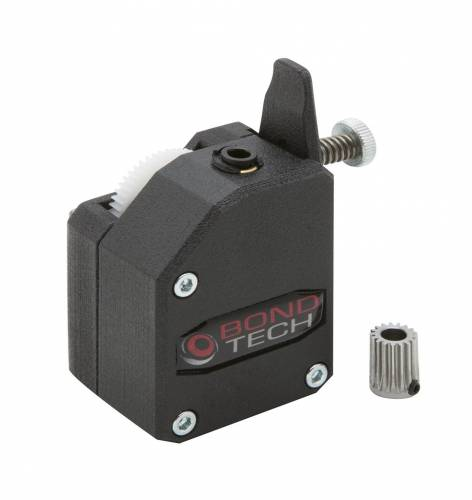
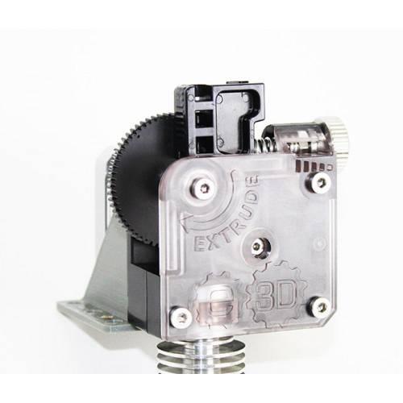

---
title: Extruders
---  

The RailCore will work with nearly any common 3D printer extruder design. Direct drive on the Y carriage is the norm.

## Bondtech LGX Lite (RailCore Mini kit)

The RailCore Mini kit uses the Bondtech LGX Lite with an E3D Revo Micro hotend. It is light, dual-drive, and a good choice for a RailCore II upgrade too. See [build guide M, Mini](../guides/guide/35-m-hotend-and-extruder.html) for how it mounts.

## Bondtech BMG (RailCore II build guide)

The RailCore II build guide uses the Bondtech BMG: 3:1 gearing and two drive gears pushing the filament. See [build guide M](../guides/guide/12-m-hotend-and-extruder.html#s80).

## E3D Titan (original default)

The first RailCores used the E3D Titan: 3:1 gearing and light enough for direct drive. Plenty of printers still run one, but it has been superseded by the extruders above.

